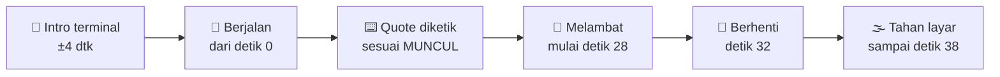

<div align="center">

# 🚶 Berjalan

### Animasi terminal: seseorang berjalan sendirian di bawah hujan, dan tubuhnya tersusun dari kode

*Satu file Python. Tanpa library. Tinggal jalankan, rekam layarnya, dan pasang quote milikmu.*

<br>


<br>

**[Fitur](#-fitur)** ·
**[Pratinjau](#-pratinjau)** ·
**[Mulai cepat](#-mulai-cepat)** ·
**[Kustomisasi](#-kustomisasi)** ·
**[Cara kerja](#-cara-kerja)** ·
**[Merekam](#-merekam-untuk-tiktok--reels)** ·
**[Masalah umum](#-masalah-umum)**

</div>

---

## 🌧️ Tentang

`berjalan.py` memainkan sebuah adegan sunyi langsung di terminalmu: seseorang berjalan pelan dengan kepala tertunduk di bawah hujan, melewati lampu-lampu jalan yang redup. Yang membuatnya berbeda, **tubuh orang itu terbentuk dari potongan kode program** yang terus mengalir di dalam siluetnya, seperti kaligrafi yang disusun dari baris-baris `try`, `except`, dan `doa("ya Allah, mudahkan")`.

Di bagian bawah layar, kalimat quote-mu diketik huruf demi huruf. Menjelang akhir, langkahnya melambat lalu **berhenti**.

Cocok untuk konten quote bernuansa sendu, motivasi, atau perjuangan dengan estetika *coding*.

---

## ✨ Fitur

| | |
|---|---|
| 🧍 **Sosok dari kode** | Kepala, leher, badan, lengan, dan kaki digerakkan dengan siklus berjalan yang lesu: tubuh condong, kepala tertunduk, lutut menekuk, pinggul naik-turun. |
| 💻 **Isi tubuh berupa kode** | Karakter di dalam siluet adalah potongan program berwarna ala editor, dan tepi siluet dibuat lebih terang agar bentuknya terbaca. |
| 🌧️ **Latar hidup** | Hujan miring, lampu jalan yang bergeser lebih lambat (efek kedalaman), dan tanah bertitik yang mengikuti langkah. |
| ⌨️ **Teks diketik** | Baris quote muncul satu per satu dengan kursor berkedip, pada detik yang bisa kamu atur. |
| 🛑 **Berhenti di akhir** | Langkah melambat halus lalu berhenti, dan penghitung `langkah = N` di pojok ikut berhenti. |
| 🔁 **Mode ulang** | Putar terus-menerus dengan `--ulang`, cocok untuk loop. |
| 🧼 **Bersih** | Memakai layar terminal terpisah dan menyembunyikan kursor. Setelah selesai atau `Ctrl+C`, terminalmu dikembalikan seperti semula. |
| 📦 **Nol dependensi** | Hanya Python standar. |

---

## 🖼️ Pratinjau

Ini dua pose dari sosoknya (diambil langsung dari keluaran kode, tanpa latar dan warna). Setiap huruf di dalam tubuh adalah bagian dari potongan program:

```text
                      kan"                                        langka
                     le·hidu                                     gkah·=·l
                    ··#·pela                                      ·if·beb
                   at:··sab                                     rint("t
                  an")··d                                      ang(dir
                  ko·=·am                                      a()··tr
                  (diri,·                                      n=True)
                  Lelah·a                                      am(e)··
                 ·cerita··                                    y:··doa(
                 h,·mudahka                                   return·la
                 ·1··whi e·h                                  :··langkah
                 jut()··  ·pe                                n-pelan··if
                 ·>·kua                                       ()··pr
                 ·jalan                                       erjuan
                ·risiko·                                      semua(
                usaha(di                                      irian=
               xcept·Lela                                     ··diam
               tidak·ceri                                     ally:·
              a·All h,·m                                    n")··r
              gkah  ·1··                                 le·hidup:
             h·=·l njut(                                ··#·pelan-
             f·be  n·>·                                  :·  abar
             ("tet p·jala                                    ef·ber
```

Aslinya ini berwarna dan bergerak: tepi siluet putih terang, isi tubuh berwarna seperti editor kode, hujan dan lampu jalan di belakangnya.

Tambahkan GIF hasil rekamanmu di folder `assets/` lalu hapus tanda komentar di bawah:

```markdown
<!--
<p align="center">
  
</p>
-->
```

---

## 🚀 Mulai cepat

**Kebutuhan:** Python 3.8 atau lebih baru. Tidak ada yang perlu di-install.

```bash
# 1. Ambil proyeknya
git clone https://github.com/USERNAME/NAMA-REPO.git
cd NAMA-REPO

# 2. Jalankan
python berjalan.py

# Atau diulang terus (tekan Ctrl+C untuk berhenti)
python berjalan.py --ulang
```

> Di macOS atau Linux, kalau `python` tidak ditemukan, pakai `python3 berjalan.py`.

### 📐 Ukuran terminal

| | Ukuran |
|---|---|
| Minimal | 60 × 20 |
| **Disarankan** | **90 × 32** atau lebih besar |
| Dipakai maksimal | 110 × 36 (di atas itu animasi tidak ikut membesar) |

Makin tinggi jendelanya, makin besar sosok yang digambar. Gunakan **tema gelap** dan **font monospace**.

---

## ⏱️ Alur adegan



Intro menampilkan `python berjalan.py` diketik, lalu log `[ ok ] memuat semua risiko`, `[warn] beban > kuat`, dan seterusnya. Semua waktu di atas bisa diubah lewat `DURASI` dan `TAHAN`.

---

## 🎨 Kustomisasi

Semua pengaturan ada di bagian atas `berjalan.py`. Buka dengan editor teks apa pun.

<details>
<summary><b>✍️ Mengisi quote</b> (yang paling sering diubah)</summary>

```python
QUOTE = [
    "tulis kalimat pertamamu di sini",
    "kalimat kedua",
    "kalimat ketiga",
]
MUNCUL = [4.0, 8.5, 13.0, 18.0, 23.5]   # detik tiap baris mulai diketik
```

- Setiap item `QUOTE` adalah **satu baris** yang diketik di bagian bawah layar. Baris pertama muncul di detik `MUNCUL[0]`, baris kedua di `MUNCUL[1]`, dan seterusnya.
- **Maksimal 5 baris.** Pastikan jumlah angka di `MUNCUL` **sama atau lebih banyak** dari jumlah baris `QUOTE`, kalau tidak program akan error.
- Usahakan tiap baris lebih pendek dari lebar jendela terminal, kalau tidak ujungnya terpotong. Pecah kalimat panjang jadi beberapa baris.
- Beri jeda yang cukup antar baris. Mengetik berjalan sekitar 30 huruf per detik, jadi baris 35 huruf butuh ±1,2 detik.

</details>

<details>
<summary><b>🐢 Kecepatan dan durasi</b></summary>

```python
DURASI = 34.0               # detik sampai langkah berhenti
TAHAN = 4.0                 # detik menahan layar di akhir
OMEGA = 2 * math.pi / 2.0   # satu siklus langkah = 2 detik (pembagi makin kecil = makin cepat)
AMP = 0.30                  # lebar ayunan kaki
KECEPATAN = 9.0             # kecepatan tanah bergeser (kolom/detik)
FPS = 24                    # bingkai per detik
```

- Mau jalannya lebih pelan dan lesu? Perbesar pembagi di `OMEGA` (misalnya `/ 2.5`) dan kecilkan `KECEPATAN`.
- Langkah mulai melambat 6 detik sebelum `DURASI` dan berhenti total 2 detik sebelumnya.
- `KECEPATAN` sebaiknya diubah bersama `OMEGA` agar langkah kaki dan gerak tanah terasa serasi.

</details>

<details>
<summary><b>💻 Mengganti kode di dalam tubuh</b></summary>

Teks yang mengisi siluet ada di variabel `KODE`:

```python
KODE = '''
def berjuang(diri):
    risiko = ambil_semua()
    try:
        usaha(diri, sendirian=True)
    except Lelah as e:
        diam(e)   # tidak cerita
    finally:
        doa("ya Allah, mudahkan")
    return langkah + 1
'''
```

Ganti dengan potongan kode atau kata-kata yang bermakna bagimu. Spasi ditampilkan sebagai titik tengah `·` supaya bentuk tubuh tetap utuh. Kata kunci yang diwarnai ada di `KATA_KUNCI`.

</details>

<details>
<summary><b>🌈 Mengganti warna</b></summary>

Warna memakai kode **ANSI 256 warna** (angka 0 sampai 255). Beberapa yang bisa kamu ubah:

| Elemen | Lokasi | Nilai awal |
|---|---|---|
| Kata kunci, string, angka, komentar | `siapkan_kode()` | `104`, `137`, `108`, `60` |
| Tepi siluet | `gambar()` bagian "sosok dari kode" | `255` |
| Hujan | `Adegan.__init__` | `23`, `24`, `60` |
| Lampu jalan | `gambar()` bagian "lampu jalan" | `137`, `94`, `238` |
| Tanah | `gambar()` bagian "tanah" | `238`, `237` |
| Teks quote | `gambar()` bagian "teks bawah" | `252` |

Cari tabel "xterm 256 colors" di internet untuk melihat warna tiap angka.

</details>

---

## 🧠 Cara kerja

<details>
<summary><b>1. Menggambar orang dari segmen</b></summary>

Tubuh didefinisikan sebagai kumpulan **segmen tebal** (pinggul ke lutut, lutut ke kaki, badan, leher, kepala, dua lengan). Posisi sendi dihitung dengan trigonometri dari satu variabel `phase` yang bertambah seiring waktu:

- ayunan kaki mengikuti `sin(phase)`,
- lutut menekuk saat kaki diayun ke depan (`cos(phase)`),
- pinggul sedikit naik-turun, dan lengan berayun berlawanan dengan kaki,
- badan sengaja condong ke depan dan kepala tertunduk supaya terkesan lesu.

Satu unit panjang sama dengan satu kolom, atau setengah baris, untuk mengimbangi karakter terminal yang tingginya sekitar dua kali lebarnya.

</details>

<details>
<summary><b>2. Mengisi siluet dengan kode</b></summary>

Setiap sel layar dicek: **seberapa dekat titik tengah sel itu ke segmen mana pun?** Kalau jaraknya lebih kecil dari ketebalan segmen, sel itu bagian dari tubuh. Sel-sel tubuh lalu diisi karakter dari teks `KODE`, dengan indeks yang terus bergeser sehingga kode seperti mengalir melewati badan. Sel yang bersebelahan dengan sel kosong ditandai sebagai tepi dan diberi warna putih terang.

</details>

<details>
<summary><b>3. Latar dan kamera</b></summary>

Sosok selalu berada di sekitar 42% lebar layar. Yang bergerak adalah dunia di belakangnya: tanah, hujan, dan lampu jalan bergeser ke kiri, seolah kamera mengikuti si pejalan. Lampu jalan digeser dengan kecepatan 35% dari tanah untuk memberi kesan kedalaman (*parallax*).

</details>

<details>
<summary><b>4. Menampilkan tanpa berkedip</b></summary>

Setiap bingkai disusun dulu sebagai satu string penuh (karakter dan kode warna ANSI), lalu ditulis sekali jalan setelah memindahkan kursor ke pojok kiri atas, bukan membersihkan layar berulang kali. Program juga:

- memakai *alternate screen* sehingga isi terminalmu sebelumnya tidak rusak,
- menyembunyikan kursor selama animasi,
- mengembalikan semuanya saat selesai atau saat `Ctrl+C`,
- memanggil `os.system("")` agar warna ANSI aktif di Windows.

</details>

---

## 📱 Merekam untuk TikTok / Reels

1. **Atur terminal:** tema gelap, font monospace, ukuran sekitar 90 × 32 atau lebih tinggi.
2. **Rekam layar** dengan perekam bawaan (Windows: `Win + Alt + R`, macOS: `Shift + Cmd + 5`, HP: perekam layar bawaan).
3. **Edit di CapCut atau editor lain:** potong intro terminal bila tidak diperlukan, pasang musik piano atau ambient yang pelan, dan sinkronkan pergantian baris quote dengan ketukan musik.
4. **Caption:** ajak interaksi, misalnya *"Siapa yang juga lagi berjuang sendirian? 🤍"*.

> ⚠️ Tidak ada yang bisa menjamin sebuah video viral. Yang bisa kamu lakukan: hook kuat di detik pertama, satu suasana yang konsisten, musik yang pas, dan video yang enak ditonton ulang.

---

## 🛠️ Masalah umum

| Masalah | Solusi |
|---|---|
| `IndexError` saat animasi berjalan | Jumlah angka di `MUNCUL` kurang dari jumlah baris di `QUOTE`. Tambahkan angka di `MUNCUL`. |
| Ujung quote terpotong | Baris lebih panjang dari jendela. Pecah jadi beberapa baris atau perbesar terminal. |
| Layar berkedip atau bergeser | Perbesar jendela terminal lalu jalankan lagi. Hindari mengubah ukuran jendela saat animasi berjalan. |
| Windows: warna atau simbol rusak | Pakai **Windows Terminal** atau terminal di **VS Code**, bukan `cmd` lama. |
| Simbol `│`, `●`, `─` terlihat lebar atau tidak sejajar | Gunakan font monospace (misalnya *Cascadia Code*, *JetBrains Mono*, atau *DejaVu Sans Mono*). |
| Animasi patah-patah | Tutup aplikasi berat lain atau kecilkan jendela terminal. |
| Terminal berantakan setelah program dihentikan paksa | Ketik `reset` lalu tekan Enter. |

---

## 📁 Struktur

```text
.
├── berjalan.py     # seluruh animasi dalam satu file
├── assets/         # (opsional) GIF dan screenshot untuk README
└── README.md
```

---

## 🤝 Kontribusi

Ide dan perbaikan sangat diterima. Buka *issue* atau kirim *pull request*.

Beberapa ide yang bisa dikerjakan:

- [ ] Opsi baris perintah untuk teks quote (`--teks "..."`) tanpa perlu mengedit file
- [ ] Pilihan tema warna (biru malam, sepia, hijau tosca)
- [ ] Sosok yang bisa berhenti lalu menoleh di akhir
- [ ] Ekspor otomatis ke GIF

---

## 📄 Lisensi

Dirilis di bawah lisensi **MIT**. Tambahkan file `LICENSE` ke repositorimu, atau ganti bagian ini dan badge di atas kalau kamu memilih lisensi lain.

---

<div align="center">

**Dibuat dengan kode, untuk kata-kata yang layak dibaca pelan.**

*Kalau proyek ini bermanfaat, beri ⭐ supaya makin banyak orang yang menemukannya.*

</div>#